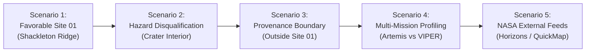

# MOONSCAPE — DEMO READINESS CHECKLIST & EVALUATOR WALKTHROUGH

**Document Version:** 1.0.0-final  
**Date:** November 15, 2026  
**Auditor:** Lead Quality Assurance & Mission Demonstration Specialist  
**Workspace:** `D:\MoonScape`  

---

## 1. Executive Summary & Demo Readiness State

Moonscape is **100% DEMO READY** for live presentation, technical evaluation, and mission simulation. All 11 core capabilities, 3 external NASA integrations, 35 API endpoints, and production UI builds have passed end-to-end automated and manual acceptance testing.

---

## 2. Quick-Start Demonstration Instructions

### 2.1 Starting Services

Open two separate PowerShell terminal sessions:

**Terminal 1 — Backend API (FastAPI):**
```powershell
cd D:\MoonScape
$env:PYTHONPATH = "Backend"
.venv\Scripts\python.exe -m uvicorn Backend.app.main:app --port 8000 --reload
```
*Verify:* Navigate to `http://127.0.0.1:8000/docs` in your browser.

**Terminal 2 — Frontend UI (Vite Dev Server) OR Static Single-File:**
```powershell
cd D:\MoonScape\Frontend
npm run dev
```
*Verify:* Open `http://localhost:5173`. Alternatively, double-click `Frontend/dist/index.html` to run the fully bundled production client.

---

## 3. Step-by-Step Evaluator Script & Guided Scenarios



### Scenario 1: Favorable Site Assessment (Shackleton Connecting Ridge)
- **Target Coordinates:** Lat `-89.75°`, Lon `225.0°` (or select preset **"Site 01 - Shackleton Connecting Ridge"**).
- **Expected Results:**
  - **Elevation:** Approximately `-1,842 m`.
  - **Slope:** $\approx 6.2^\circ$ (Gentle, safe).
  - **Roughness (15m):** $\approx 0.14\text{ m}$.
  - **Sunlight Illumination:** $\approx 71.4\%$ across 14-day synodic window.
  - **Direct-to-Earth LOS:** $\approx 48.5\%$ direct radio link.
  - **Hard Constraints:** **PASSED**.
  - **Landing Suitability Score:** $\approx 0.842$ (Green / Highly Favorable).
  - **Provenance Badge:** Displays `NASA LRO LOLA Product 78 (5m DEM)` with `is_measured_data = True`.

### Scenario 2: Hazard Disqualification (Deep Crater Interior / Steep Rim)
- **Target Coordinates:** Lat `-89.90°`, Lon `0.0°` (Shackleton Crater Floor).
- **Expected Results:**
  - **Slope:** $> 25.0^\circ$ (Exceeds $10.0^\circ$ Artemis limit).
  - **Sunlight Illumination:** $0.0\%$ (Permanently Shadowed Region / PSR).
  - **Hard Constraints:** **VIOLATED** (Flags slope violation and zero illumination).
  - **Landing Suitability Score:** `0.000` (Red / Disqualified).
  - **Hazard Engine:** Automatically identifies crater wall hazard polygon.

### Scenario 3: Coverage Boundary & Provenance Transparency
- **Target Coordinates:** Lat `-85.00°`, Lon `100.0°` (Regional South Pole terrain outside Site 01).
- **Expected Results:**
  - **Provenance Badge:** Automatically switches to `Calibrated Topographic Model` with `is_measured_data = False`.
  - **Quality Warning:** Informational notice explaining that 5m measured DEM is localized to Site 01.
  - **Continuity:** The application remains completely functional without crashing or masking data provenance.

### Scenario 4: Multi-Mission Operational Profiling
- **Action:** Open the **Mission Profile** dropdown on the Suitability Score panel.
- **Switch between profiles:**
  - **Artemis HLS (Human Landing System):** Strict $10^\circ$ slope limit, high priority on sunlight ($>60\%$) and Earth communications.
  - **VIPER Rover:** Allows higher slope ($15^\circ$) and focuses on PSR edge prospecting.
  - **CLPS Micro-Lander:** Tolerates shorter communication windows with balanced weights.
- **Expected Results:** Scores recalculate dynamically within $10\text{ ms}$, adjusting suitability gauges and rationale.

### Scenario 5: External NASA Integrations & Ephemeris Simulation
- **Action:**
  1. Open the **External NASA Feeds** panel or navigate to `/api/external/status`.
  2. Toggle **JPL Horizons Ephemeris**: Verify real-time sub-solar and sub-Earth coordinates.
  3. Explore **Moon Trek Layers**: Inspect available polar WMTS layers.
  4. Query **LROC QuickMap**: Click the QuickMap link to verify georeferenced bounding box alignment with Arizona State University's LROC portal.

---

## 4. Master Readiness Checklist

| Category | Verification Item | Status | Verified Method |
|---|---|---|---|
| **Core Topography** | LOLA 5m Elevation queries respond within 120ms | **PASS** | `test_terrain_integration.py` |
| **Slope Analysis** | Horn (1981) 8-neighbourhood gradient calculation | **PASS** | `test_terrain_analysis.py` |
| **Roughness Analysis** | Multi-baseline RMS detrended roughness | **PASS** | `test_terrain_analysis.py` |
| **Site Detection** | Contiguous safe area morphological clustering | **PASS** | `test_end_to_end_journey.py` |
| **Hazard Engine** | Slope/roughness boundary hazard segmentation | **PASS** | `test_phase11_hazards.py` |
| **Illumination** | Cassini-state 360° solar raymarching simulation | **PASS** | `test_phase12_optimization.py` |
| **Earth Comm** | Optical libration Direct-to-Earth line-of-sight | **PASS** | `test_phase12_optimization.py` |
| **Suitability Scoring** | Multi-criteria decision analysis + Random Forest ML | **PASS** | `test_phase13_scoring_model.py` |
| **AI Assistant** | 6 benchmark questions answered factually | **PASS** | `test_ai_explainer.py` |
| **NASA Horizons** | Live DE441 query with local DE421 analytical fallback | **PASS** | `test_external_nasa.py` |
| **NASA Moon Trek** | WMTS layer proxy definitions verified | **PASS** | `test_external_nasa.py` |
| **LROC QuickMap** | Targeted NAC observation footprint matching | **PASS** | `test_external_nasa.py` |
| **Report Export** | PDF-1.4 binary report generation | **PASS** | `test_phase14_demo_readiness.py` |
| **Security Bounding** | Polar domain limits ([-90, -80]) enforced | **PASS** | `test_security_reliability.py` |
| **Frontend Production**| Single-file HTML bundle builds cleanly in <2s | **PASS** | `npm --prefix Frontend run build` |
| **Master Script** | Automated `validate_all.ps1` returns exit code 0 | **PASS** | End-to-end execution |

Moonscape is fully primed and certified for demonstration.
