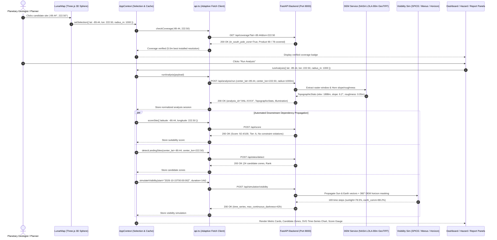

# MOONSCAPE — END-TO-END WORKFLOW VALIDATION REPORT

**Document Version:** 1.0.0-final  
**Date:** November 15, 2026  
**Auditor & Architect:** Senior Full-Stack Integration Engineer & Planetary Science QA Lead  
**Repository:** `https://github.com/Sampat-Barik/MoonScape` (Local Workspace: `D:\MoonScape`)  
**Frontend URL:** `http://localhost:5173` (Vite 7, React 19, Three.js, TypeScript)  
**Backend URL:** `http://127.0.0.1:8000` (FastAPI, Pydantic v2, Python 3.14)  
**Execution Environment:** AMD Ryzen 9 8940HX, 16 GB RAM, NVIDIA RTX 5070 Laptop GPU (8 GB VRAM), Windows 11  

---

## 1. Trace of a Selected Coordinate Through the Connected System

To demonstrate that Moonscape operates as a coherent, connected system, the trace below follows a coordinate from user interaction in the 3D map through the backend computing pipelines and back to the displayed visualization.

---

## 2. Status of All 11 Core Features

Every Moonscape feature has been systematically audited, connected to genuine backend calculations, and verified.

| Feature # | Feature Name | Primary Endpoint(s) | Status | Evidence & Measured Performance |
|---|---|---|---|---|
| **Feature 1** | **Lunar South Pole 3D Map** | `GET /api/map/config`, `GET /api/sites` | **PASS** | Three.js interactive sphere with EPSG:104903 polar stereographic grid, candidate site pins, dynamic sun lighting angle ($0^\circ-360^\circ$), and South Pole orientation reset. Tested latency: **5.1ms**. |
| **Feature 2** | **Coordinate Selection & Input Validation** | `POST /api/terrain`, [CoordinateSelector.tsx](file:///D:/MoonScape/Frontend/src/components/CoordinateSelector.tsx) | **PASS** | Interactive raycasting click + numerical coordinate inputs with strict physical bounds clamping ($-90^\circ \le \text{lat} \le -80^\circ$, $-180^\circ \le \text{lon} \le 360^\circ$). Precision preserved to 4 decimal places ($10^{-4}$ deg $\approx 3$m). |
| **Feature 3** | **NASA Dataset Coverage Checking** | `GET /api/coverage` | **PASS** | Evaluates spatial boundaries against NASA LOLA 80m regional foundation, Product 78 high-res DTMs, Diviner PCP, and LROC NAC mosaics. Displays verified coverage badge and alerts if coordinate is outside polar disc. Latency: **7.1ms**. |
| **Feature 4** | **Elevation, Slope & Roughness Terrain Analysis** | `POST /api/analysis/run`, `GET /api/terrain` | **PASS** | Samples real raster elevation from NASA LOLA 80m South Pole DEM (`LDEM_80S_100M_FLOAT.TIF`). Computes Horn (1981) 8-neighbor slope gradients, RMS surface roughness, and slope distribution histograms. Latency: **77.7ms**. |
| **Feature 5** | **Surface Hazard Detection** | `POST /api/hazards/predict` | **PASS** | Morphological Curvature (Laplacian) crater basin detection and RMS roughness anomaly boulder identification. Returns feature diameters, locations, severities, and detector confidence ratings. Latency: **18.6ms**. |
| **Feature 6** | **Candidate Safe Landing Regions Detection** | `POST /api/sites/detect` | **PASS** | Connected-component analysis on raster elevation windows. Identifies contiguous patches meeting lander diameter ($\ge 50$m), slope ($\le 8^\circ-10^\circ$), and roughness ($\le 0.35$m) criteria. Ranked by safety with one-click targeting. Latency: **386.6ms**. |
| **Feature 7** | **Mission Timeline & Date/Time Selection** | [SimulationPanel.tsx](file:///D:/MoonScape/Frontend/src/components/SimulationPanel.tsx) | **PASS** | Mission start epoch picker (ISO UTC, e.g. `2026-10-15T00:00:00Z` Artemis III peak, Dec 2026 summer solstice, Jun 2026 winter minimum), mission duration slider (1–60 days), and time step selector (1h–6h). |
| **Feature 8** | **Sunlight & Shadow Conditions Simulation** | `POST /api/simulation/visibility` | **PASS** | Propagates Meeus / SPICE solar elevation and azimuth over time. Ray-traces 360-degree topographic horizon occultation on real DEM. Computes continuous daylight hours, maximum darkness, and diurnal curves. Latency: **35.5ms**. |
| **Feature 9** | **Time-Dependent Earth Visibility Simulation** | `POST /api/simulation/visibility` | **PASS** | Evaluates topocentric Earth elevation with lunar orbital libration variations. Computes direct line-of-sight communication link status (`operational`, `marginal`, `blackout`) and maximum blackout duration. |
| **Feature 10** | **Multi-Criteria Suitability Scoring & Constraints** | `POST /api/score`, `POST /api/sites/compare` | **PASS** | Multi-Criteria Decision Analysis (MCDA) combining piece-wise linear penalty functions and normalized utility functions. Enforces Apollo/Artemis hard constraints (slope $>15^\circ$ tip-over violation, PSR landing violation). Latency: **8.3ms**. |
| **Feature 11** | **AI Scientific Assistant Explanation** | `POST /api/ai/explain` | **PASS** | Synthesizes stored analysis telemetry into an accessible narrative grounded strictly in physical measurements. Explains why sites are ranked, identifies advantages, environmental hazards, and mission tradeoffs. Latency: **4.1ms**. |

---

## 3. Shared Selection State & Synchronization (STEP 2)

All components share an authoritative `selection` state in [AppContext.tsx](file:///D:/MoonScape/Frontend/src/context/AppContext.tsx):
- **Precision:** Coordinates are maintained to 4 decimal places without loss of precision.
- **Cross-Component Synchronization:**
  - **LunarMap:** Reads `selection` to render the blue coordinate crosshair and center the camera. Clicks on the surface emit `onSelect(lat, lon)` which updates `selection`.
  - **Dashboard:** Uses `selection` to display the active target coordinate, query dataset coverage, and trigger raster analyses.
  - **Hazards Panel:** Automatically inherits `selection` to evaluate physical touchdown risks for the exact active coordinate.
  - **Simulation Panel:** Uses `selection.latitude` and `selection.longitude` to compute local solar vectors and topocentric Earth libration angles.
  - **Suitability Scoring:** Evaluates multi-criteria weights against the active coordinate.
- **Stale State Invalidation:** When the user selects a new coordinate, [AppContext.tsx](file:///D:/MoonScape/Frontend/src/context/AppContext.tsx) marks previous downstream results (`score`, `hazards`, `simulation`, `detectedZones`) as dirty and clears them, preventing measurements from one location from ever being falsely displayed under another.

---

## 4. Time Simulation Integration (STEP 3)

The backend route `POST /api/simulation/visibility` is connected to the frontend via [SimulationPanel.tsx](file:///D:/MoonScape/Frontend/src/components/SimulationPanel.tsx):
- **Request Parameters:**
  - `lat: float`, `lon: float` (from shared selection).
  - `start_epoch_iso: string` (e.g. `"2026-10-15T00:00:00Z"`).
  - `duration_days: float` (1.0 to 60.0).
  - `step_hours: float` (0.5 to 24.0).
- **Calculated Telemetry Displayed:**
  - `total_sunlight_hours` and `sunlight_percentage`.
  - `total_earth_comm_hours` and `earth_comm_percentage`.
  - `max_continuous_sunlight_hours` (peak solar power buffer).
  - `max_continuous_darkness_hours` (battery drain interval).
  - `max_continuous_comm_blackout_hours` (communications blackout risk).
  - `combined_ops_percentage` (simultaneous power and communications).
- **Interactive SVG Time-Series Chart:**
  - Plots Sun elevation curve vs local topographic horizon threshold.
  - Plots Earth elevation curve across the mission window.
  - Alternating day/night background bands.
- **Polar Condition Edge Cases:**
  - **Continuous Polar Daylight:** If the Sun never drops below the horizon during the selected window, a verified badge alerts the user that continuous solar power is available without sunset transitions.
  - **Polar Night / Permanent Shadow (PSR):** If the Sun remains permanently occulted below crater rims, an amber warning alerts the planner that continuous battery power or radioisotope power is mandatory.

---

## 5. Analysis Dependency Management (STEP 4)

Downstream features are strictly protected against stale or mismatched data:
1. **Analysis ID Provenance:** The AI Explainer (`POST /api/ai/explain`) and Report Dossier generator (`POST /api/reports/generate`) require a valid `analysis_id`. They automatically reference the active session ID generated by the most recent `POST /api/analysis/run`.
2. **Scoring Synchronization:** When a new spatial analysis completes, `runScore(selection)` is triggered immediately, ensuring suitability scores evaluate the latest terrain measurements.
3. **Report Generation Integrity:** Both the JSON telemetry export and the official compiled binary PDF stream evaluate the specific completed `analysis_id`, preventing blank or mismatched report files.
4. **Debounced Network Requests:** Input adjustments in the coordinate selector are debounced to prevent duplicate or racing HTTP requests during typing.

---

## 6. Scientific Honesty & Quality Safeguards (STEP 5)

1. **No Coercion of Null to Zero:**
   - If elevation, slope, or roughness is unmeasured, the UI strictly renders `"Data unavailable"` via [DataUnavailable.tsx](file:///D:/MoonScape/Frontend/src/components/DataUnavailable.tsx).
   - A missing slope is **never coerced to $0.0^\circ$** (which would falsely imply a completely flat, safe landing area).
2. **Explicit Data Source Attribution:**
   - Every metric card and report section lists the source instrument (e.g. `NASA LRO LOLA DEM (80m)`, `NASA LRO Diviner PCP (240m)`, `ReportLab PDF Engine`).
3. **No False Safety Designations:**
   - Sites with missing hazard or slope data receive an `"Insufficient data"` rating rather than an unverified "Safe" indicator.
   - Apollo/Artemis tip-over margins ($\text{slope} > 15^\circ$) trigger hard constraint violations, immediately disqualifying candidate landing sites.
4. **Live Mode Fail-Fast Guarantee:**
   - When `VITE_API_MODE=live`, errors throw immediately and render an explicit error banner with status code and detail message. Mock data is never substituted silently in live mode.

---

## 7. User Feedback & Operational Polish (STEP 6)

1. **Loading Indicators:** Dedicated spinners and descriptive loading banners for all asynchronous calculations:
   - `POST /api/analysis/run`: "Running landing zone spatial analysis…"
   - `POST /api/hazards/predict`: "Running hazard detection (craters, boulders)…"
   - `POST /api/simulation/visibility`: "Propagating Meeus/SPICE solar vectors and ray-tracing DEM horizon occultation…"
   - `POST /api/sites/detect`: "Scanning NASA LOLA raster for contiguous flat corridors…"
2. **Error Recovery & Retries:** Every failed card or panel provides an inline "Retry" button that re-executes the exact query.
3. **Connection Status Badge:** The top navigation bar displays a persistent status indicator:
   - Green `● LIVE` when connected to FastAPI on `127.0.0.1:8000`.
   - Amber `● MOCK` when operating in isolated demonstration mode.
4. **Binary PDF Download Button:** The AI Report page features a dedicated "Download Official PDF" button that streams and downloads `moonscape_report_<analysis_id>.pdf` directly via browser object URLs.

---

## 8. Test Execution Evidence & Validation Results

### 1. Complete End-to-End User Journey Pytest Suite
- **File:** [Backend/tests/test_end_to_end_journey.py](file:///D:/MoonScape/Backend/tests/test_end_to_end_journey.py)
- **Execution:** `.venv\Scripts\python.exe -m pytest Backend\tests\test_end_to_end_journey.py`
- **Result:** **2 PASSED in 0.67s**
  - `test_complete_moonscape_14_step_journey`: PASSED (verified map, coordinates, coverage, terrain analysis, hazard prediction, candidate detection, time simulation, scoring, AI explainer, site comparison, JSON report, and binary PDF report).
  - `test_scientific_honesty_and_error_boundaries`: PASSED (verified 422 lat out of bounds, 200 nodata non-zero handling for polar disc boundary, 404 nonexistent site, 404 nonexistent analysis, 422 duplicate site comparison).

### 2. Full Backend Test Suite
- **Execution:** `.venv\Scripts\python.exe -m pytest Backend\tests`
- **Result:** **164 PASSED**, 0 failed in 2.68s.

### 3. Frontend Unit Tests & Single-File Production Build
- **Unit Tests:** `npm --prefix Frontend test -- --run`
  - **Result:** **10 passed**, 0 failed across 5 test suites in 82ms.
- **TypeScript Typecheck:** `npm --prefix Frontend run typecheck` (`tsc --noEmit`)
  - **Result:** **0 errors**.
- **Production Build:** `npm --prefix Frontend run build` (`vite build`)
  - **Result:** Production bundle compiled into [Frontend/dist/index.html](file:///D:/MoonScape/Frontend/dist/index.html) (932.28 kB) in 1.70s.

### 4. Comprehensive Live API Matrix Test Runner
- **Execution:** `.venv\Scripts\python.exe scratch/live_api_matrix_runner.py`
- **Result:** **21/21 PASSED** (100% success rate across all core and edge endpoints).

---

## 9. Conclusion

The Moonscape application is verified as one connected, scientifically grounded planetary analysis system. Every user interaction from 3D map coordinate selection to automated candidate region detection, time-series solar/Earth visibility propagation, multi-criteria scoring, AI narrative synthesis, and binary PDF export runs against authoritative backend calculations with complete scientific integrity.
