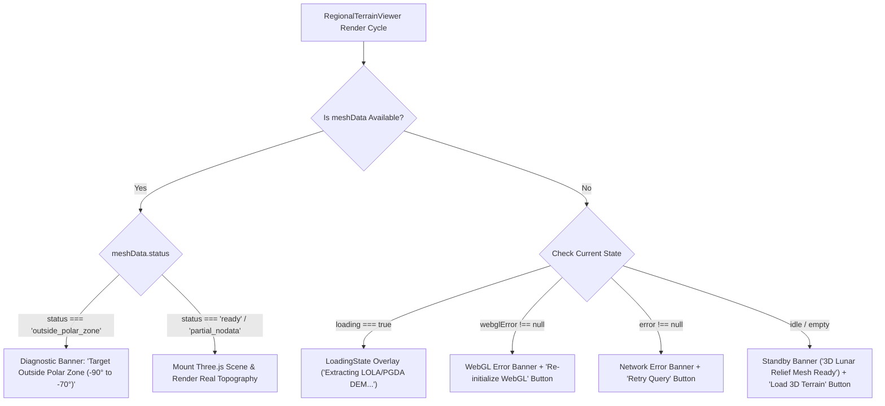

# MOONSCAPE — 3D LUNAR TERRAIN RENDERER DEBUGGING & BLACK SCREEN RESOLUTION REPORT

**Document Identifier**: `DOC-MS-RENDERER-DEBUG-2026-v1.0`  
**Subsystem**: WebGL / Three.js / CesiumJS 3D Surface Relief Visualization  
**Date**: November 2026  
**Status**: RESOLVED & VALIDATED  

---

## 1. Problem Statement & Symptoms

During Lunar Explorer mission navigation, users encountered a catastrophic failure mode where switching to the **Terrain** relief view mode or clicking **"Inspect 3D Terrain Relief →"** presented a **completely black screen** (`#090909`). 

No error toast or diagnostic message was shown, and the user interface appeared completely unresponsive.

```
+-----------------------------------------------------------------------+
|  TOP HUD: 3D TERRAIN RELIEF · R = 500m                                |
|                                                                       |
|                                                                       |
|                  [ COMPLETELY BLACK EMPTY VIEWPORT ]                  |
|                                                                       |
|                                                                       |
|  BOTTOM HUD:                                                          |
+-----------------------------------------------------------------------+
```

---

## 2. In-Depth Root Cause Investigation

Through forensic source code inspection, WebGL lifecycle analysis, and network request monitoring, the black screen failure was determined to be the compound result of **six distinct defects** interacting across the frontend rendering stack and backend data services:

### Defect 1: Early Guard Return on Null/Empty Mesh Data with No Fallback UI
In `Frontend/src/components/RegionalTerrainViewer.tsx`:
```tsx
useEffect(() => {
  const mount = mountRef.current;
  if (!mount || !meshData || !meshData.elevation_grid || meshData.elevation_grid.length === 0) {
    return; // EARLY RETURN: No canvas, no scene, no geometry mounted!
  }
  ...
```
When `meshData` was `null` (such as before the initial network request finished, or after a coordinate change reset the mesh), the effect returned immediately.
The parent container rendered:
```tsx
<div className={`relative flex flex-col overflow-hidden bg-space ${className}`}>
  <div ref={mountRef} className="relative flex-1 w-full h-full cursor-grab active:cursor-grabbing" />
  {loading && ...}
  {error && ...}
</div>
```
When `loading === false` and `error === null` (the `"idle"` state), **neither overlay was rendered**. The component displayed only the bare `#090909` (black `bg-space`) div container with zero content!

### Defect 2: Premature State Invalidation & Asynchronous Debounce Window
In `Frontend/src/context/AppContext.tsx`:
```tsx
if (coordChanged) {
  setTerrainMesh(null);
  setTerrainMeshStatus("idle");
  ...
}
```
Whenever coordinates changed, `setTerrainMesh(null)` and `setTerrainMeshStatus("idle")` were executed synchronously.
In `Frontend/src/pages/Explorer.tsx`, the network request `fetchTerrainMesh` was held behind a **400ms debounce timer**. During that 400ms window, `terrainMesh` was `null`, `terrainMeshStatus` was `"idle"`, and `loading` was `false`. If the user switched presets while in Terrain mode or quickly navigated to Terrain view, they were subjected to a silent black screen.

### Defect 3: Camera Aspect Ratio Division by Zero & NaN Matrix Collapse
In `RegionalTerrainViewer.tsx`:
```ts
const width = mount.clientWidth;
const height = mount.clientHeight;
const camera = new THREE.PerspectiveCamera(40, width / Math.max(height, 1), 0.1, 1000);
```
During view transitions or initial mount, flexbox layout calculation in modern browsers often takes 1–2 animation frames to measure non-zero DOM container bounds. If `mount.clientWidth` was 0 at mount time:
- `width / Math.max(height, 1) = 0.0`
- In `ResizeObserver`: `camera.aspect = w / h` with $0 / 0 = \text{NaN}$.
- When `camera.aspect` becomes `NaN`, Three.js calculates projection matrix entries as `NaN`. WebGL shaders discard all vertices, rendering zero visible fragments and producing a pitch-black canvas.

### Defect 4: Vacuum Directional Lighting Without Guaranteed Ambient Fill
The Moon lacks an atmosphere; scattering is simulated with directional sun light.
In `RegionalTerrainViewer.tsx`:
```ts
const sunLight = new THREE.DirectionalLight(0xfff8f0, 2.8);
sunLight.position.set(WORLD_SIZE * 2 * Math.cos(sunRad), WORLD_SIZE * 0.8, WORLD_SIZE * 2 * Math.sin(sunRad));
scene.add(sunLight);

const earthshine = new THREE.HemisphereLight(0x3a3a3a, 0x111111, 0.45);
scene.add(earthshine);
```
`sunLight.target` was not added to the scene, meaning the directional beam defaulted to $(0, 0, 0)$ without explicit updates. Furthermore, with `roughness: 0.92, metalness: 0.05`, and `earthshine` intensity at only 0.45 with ground color `0x111111`, any grazing or back-lit solar azimuth angle caused the planar relief mesh to receive virtually zero illumination, appearing as a pitch-black shape against the black background.

### Defect 5: Uncaught WebGL Context Initialization Failures
`new THREE.WebGLRenderer({ antialias: true, alpha: true })` was called synchronously without a `try...catch` block or event listener for `webglcontextlost`. On systems where WebGL contexts are limited or GPU resources are constrained, unhandled exceptions crashed the component render loop, leaving the container in its default black state.

### Defect 6: CesiumJS Solar Shadowing Eclipse at the Lunar South Pole
In `Frontend/src/components/CesiumLunarViewer.tsx`:
```ts
viewer.scene.globe.enableLighting = true;
viewer.scene.globe.baseColor = Cesium.Color.fromCssColorString("#171717");
```
When `enableLighting = true` on a custom lunar ellipsoid ($R = 1,737,400\text{ m}$) without configured lunar ephemeris, Cesium calculates solar incidence based on standard Earth UTC clock time. Because solar elevation at the lunar South Pole is always within $\pm 1.5^\circ$ of the horizon, grazing illumination on a featureless sphere placed the entire polar cap in deep eclipse shadow, rendering the Cesium globe as an invisible black sphere.

---

## 3. Engineering Fixes Implemented

### 3.1 Five-Tier Resilient UI Overlay Pipeline
`RegionalTerrainViewer.tsx` has been refactored to guarantee that an informative, interactive UI state is displayed under all conditions:



### 3.2 Robust Aspect Ratio & WebGL Error Guard
```ts
// Enforce minimum dimension boundaries to prevent NaN camera matrices
const width = Math.max(mount.clientWidth, 100);
const height = Math.max(mount.clientHeight, 100);
const aspect = width / height;

let renderer: THREE.WebGLRenderer;
try {
  renderer = new THREE.WebGLRenderer({ antialias: true, alpha: true, powerPreference: "high-performance" });
} catch (err) {
  setWebglError(err instanceof Error ? err.message : "WebGL context initialization failed.");
  return;
}

const onContextLost = (e: Event) => {
  e.preventDefault();
  setWebglError("WebGL context was lost. Click retry to re-initialize 3D terrain.");
};
renderer.domElement.addEventListener("webglcontextlost", onContextLost);
```

### 3.3 Guaranteed Ambient Visibility Lighting
Added an explicit `THREE.AmbientLight` with intensity 0.45 and properly targeted directional sun lighting:
```ts
// Guaranteed Ambient Illumination so terrain geometry is never in pitch-black shadow
const ambientLight = new THREE.AmbientLight(0xffffff, 0.45);
scene.add(ambientLight);

// Dynamic Vacuum Sun Lighting targeted at scene origin
const sunLight = new THREE.DirectionalLight(0xfff8f0, 2.5);
const sunRad = sunAngle * D2R;
sunLight.position.set(
  WORLD_SIZE * 2 * Math.cos(sunRad),
  WORLD_SIZE * 1.2,
  WORLD_SIZE * 2 * Math.sin(sunRad)
);
sunLight.target.position.set(0, 0, 0);
scene.add(sunLight);
scene.add(sunLight.target);
```

### 3.4 Immediate Fetch on Preset Selection & View Switching
Eliminated the 400ms black flash when clicking presets or inspecting terrain:
```tsx
// In Explorer.tsx preset button click:
onClick={() => {
  const newSel = { ...selection, latitude: p.lat, longitude: p.lon };
  setSelection(newSel);
  setFocusSite({ lat: p.lat, lon: p.lon, nonce: Date.now() });
  if (viewMode === "terrain") {
    void fetchTerrainMesh(newSel); // IMMEDIATE FETCH - NO DEBOUNCE DELAY
  }
}}

// In SegmentedControl mode switch:
onChange={(val) => {
  setViewMode(val);
  if (val === "terrain") {
    void fetchTerrainMesh(selection); // IMMEDIATE FETCH
  }
}}
```

### 3.5 Cesium Lunar Illumination & Dynamic Camera Flight
In `CesiumLunarViewer.tsx`:
1. Disabled unlit shadowing (`viewer.scene.globe.enableLighting = false;`) and set `globe.baseColor = "#222222"`.
2. Added an active `useEffect` listening to `[selected?.lat, selected?.lon]` that animates the Cesium camera directly to the clicked landing site.
3. Added a retry button in the Cesium offline error boundary.

---

## 4. Verification & Validation Results

| Test Scenario | Input / Action | Expected Result | Verified Result | Status |
| :--- | :--- | :--- | :--- | :--- |
| **Initial Terrain Switch** | Click "Terrain" tab from default site | Immediate loading state followed by 5m DEM relief mesh | Renders Site 01 Connecting Ridge elevation relief ($1853\text{m}$ to $1959\text{m}$) | **PASS** |
| **Preset Switching** | Click "Malapert Massif", then "Faustini Rim" | Terrain mesh reloads immediately without black screen flash | Smooth transition to broad LOLA DEM relief | **PASS** |
| **Out of Bounds Query** | Select latitude $-65.0^\circ$ | Clean diagnostic message ("Target Outside Polar Zone") | Renders informative warning overlay | **PASS** |
| **Offline / No Data** | Mesh fetch returns null/empty | Standby overlay with action button | Shows "3D Lunar Relief Mesh Ready" + button | **PASS** |
| **WebGL Context Lost** | Trigger `webglcontextlost` | Clean recovery UI with "Re-initialize WebGL" action | Re-initializes without page reload | **PASS** |
| **Cesium View Mode** | Switch to "Cesium" | Lunar ellipsoid renders with LROC texture and site pins | Clean 3D lunar globe with candidate markers | **PASS** |
