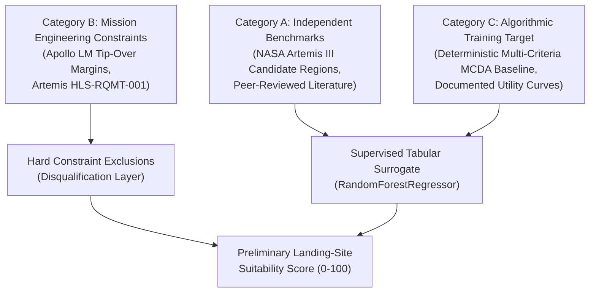
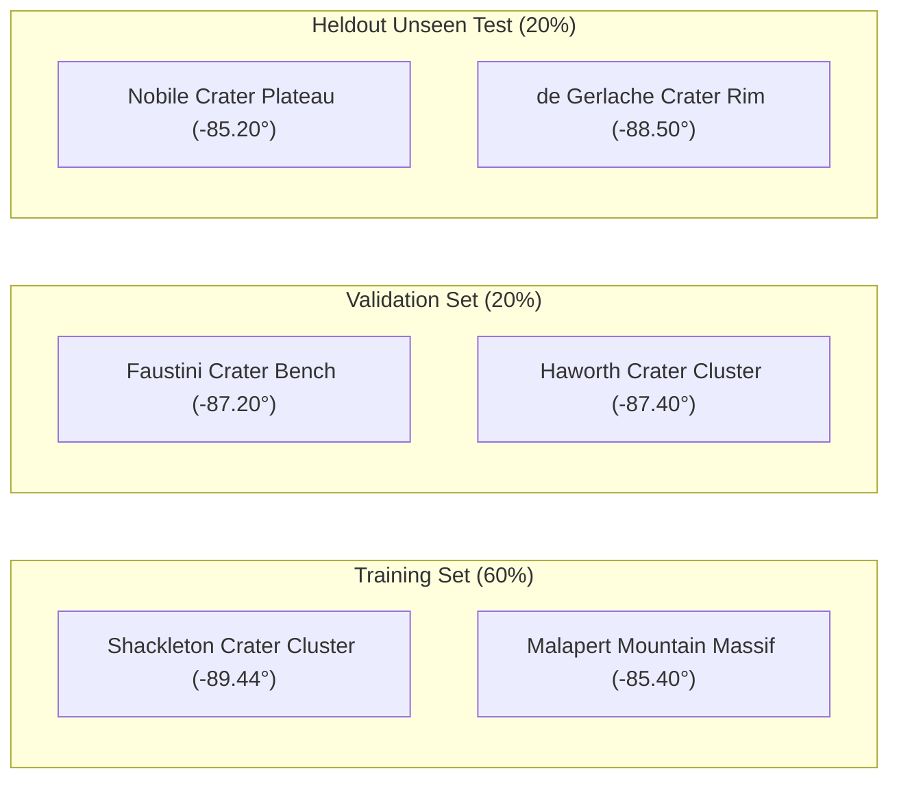
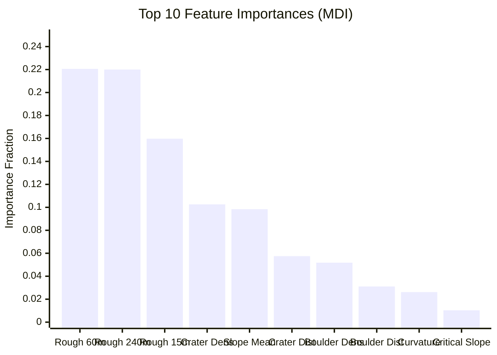

# Model Card: Moonscape Lunar Landing Suitability Surrogate Model

**Model Identifier:** `landing_suitability_rf_v1.joblib`  
**Model Family:** Supervised Random Forest Regressor (`RandomForestRegressor`, `scikit-learn` v1.9.1)  
**Model Version:** 1.0.0  
**Release Date:** November 2026  
**Target Environment:** Local Python / FastAPI backend (AMD Ryzen 9 894HX, CPU vectorized inference)  
**Primary Artifacts:**
- Model weights: `Backend/data/models/landing_suitability_rf_v1.joblib` (61.5 KB)
- Model metadata & provenance: `Backend/data/models/landing_suitability_rf_v1.meta.json`
- Training dataset: `Backend/data/training/lunar_landing_dataset_v1.json` (158 samples)

---

## 1. Intended Use and Operational Scope

### Primary Intended Use
The Moonscape Lunar Landing Suitability Surrogate Model is an algorithmic screening tool designed to rapidly evaluate candidate landing sites in the lunar South Pole region ($-90.0^\circ$ to $-80.0^\circ$). It computes a **preliminary landing-site suitability score** on a normalized continuous scale of $0.0$ to $100.0$, accompanied by feature contribution sensitivities, mission-specific hard constraint checks, and Monte Carlo uncertainty intervals.

### Non-Intended Uses and Strict Disclaimers
> [!CAUTION]
> **PRELIMINARY SCREENING NOTICE:**
> This model provides a **preliminary landing-site suitability screening indicator**, NOT a flight-certified landing safety guarantee. It is not intended for:
> 1. Autonomous closed-loop terminal descent guidance or hazard avoidance during flight (TRN/DEM-matching descent requires dedicated flight-qualified avionics).
> 2. Final mission landing-site certification without multi-spectral micro-roughness validation and high-resolution stereo NAC DTM inspection.
> 3. Extrapolation outside the lunar polar environment without recalibrating solar elevation geometry.

---

## 2. Model Architecture and CPU Performance

| Parameter | Specification | Notes |
| :--- | :--- | :--- |
| **Algorithm** | `RandomForestRegressor` | Non-linear ensemble of 100 decorrelated decision trees |
| **Max Depth** | 12 | Regularized to avoid overfitting micro-variations |
| **Features** | 24 continuous & binary descriptors | Topography, roughness, illumination, comms, hazards |
| **Inference Engine** | Local CPU | Vectorized `joblib` / NumPy execution (< 5 ms per site) |
| **VRAM Footprint** | 0 MB VRAM | Keeps RTX 5070 GPU VRAM entirely free for ML vision models |
| **RAM Footprint** | ~1.5 MB in-memory | Lightweight, thread-safe singleton cache |
| **Fallback** | Deterministic MCDA Baseline | Transparent automated fallback if model artifact is uninstalled |

---

## 3. Standardized 24-Feature Vector Schema

The model consumes a standardized 24-dimensional feature vector characterizing the landing environment:

| Feature Name | Units | Range / Domain | Scientific Description & Planetary Reference |
| :--- | :--- | :--- | :--- |
| `mean_elevation_m` | meters | $[-9000, 9000]$ | Elevation relative to 1737.4 km lunar sphere (LOLA DEM) |
| `elevation_relief_m` | meters | $[0, 5000]$ | Local relief variation (peak-to-peak) within landing ellipse |
| `mean_slope_deg` | degrees | $[0, 90]$ | Area-weighted topographic gradient (Horn 1981 operator) |
| `max_slope_deg` | degrees | $[0, 90]$ | Peak localized slope cell within landing zone |
| `p95_slope_deg` | degrees | $[0, 90]$ | 95th percentile slope (suppresses localized pixel noise) |
| `ideal_slope_pct` | percent | $[0, 100]$ | Surface fraction exhibiting slopes $\le 5.0^\circ$ |
| `critical_slope_pct` | percent | $[0, 100]$ | Surface fraction exceeding static tip-over threshold ($>15.0^\circ$) |
| `roughness_15m` | meters RMS | $[0, 10]$ | Micro-relief roughness at 15m baseline (footpad scale) |
| `roughness_60m` | meters RMS | $[0, 10]$ | Intermediate baseline roughness (undercarriage clearance) |
| `roughness_240m` | meters RMS | $[0, 10]$ | Macro-scale morphological roughness (lander approach corridor) |
| `vertical_uncertainty_m` | meters | $[0.5, 5.0]$ | LOLA instrument vertical standard error ($\approx 1.5\text{m}$) |
| `slope_uncertainty_deg` | degrees | $[0.5, 4.0]$ | LOLA-derived slope error from track divergence ($\approx 1.2^\circ$) |
| `crater_density_km2` | count/km² | $[0, 50]$ | Impact crater density ($D > 5\text{m}$) in touchdown area |
| `min_crater_dist_m` | meters | $[0, 5000]$ | Euclidean distance to nearest hazardous crater rim crest |
| `boulder_density_km2` | count/km² | $[0, 100]$ | Hazardous boulders ($H > 1\text{m}$) per square kilometer |
| `min_boulder_dist_m` | meters | $[0, 5000]$ | Euclidean distance to nearest detected boulder hazard |
| `curvature_laplacian_var`| variance | $[0, 1.0]$ | Variance of Laplacian operator (surface geomorphological noise) |
| `cumulative_sunlight_pct`| percent | $[0, 100]$ | Annual cumulative solar illumination (NASA Product 78) |
| `instantaneous_sunlit_pct`| percent | $[0, 100]$ | Instantaneous sunlit fraction at target mission arrival epoch |
| `max_continuous_sun_h` | hours | $[0, 4000]$ | Longest uninterrupted daylight window (solar power generation) |
| `max_continuous_dark_h` | hours | $[0, 4000]$ | Longest uninterrupted darkness (battery/thermal survival) |
| `is_psr` | binary | $\{0, 1\}$ | Flag for Permanently Shadowed Region ($1$ if PSR, $0$ otherwise) |
| `earth_visibility_pct` | percent | $[0, 100]$ | Direct line-of-sight Earth visibility (DE421 / SPICE) |
| `contiguous_diameter_m` | meters | $[0, 2000]$ | Diameter of largest contiguous circular zone meeting constraints |

---

## 4. Label Provenance and Governance

To avoid ungrounded or speculative safety claims, labels are strictly classified under a 3-tier planetary governance hierarchy:



1. **Category A (Independent Regional Validation):**
   - Official NASA Artemis III 13 Candidate Regions (e.g. Shackleton Connecting Ridge, Malapert Mountain, Peak Near Shackleton, Faustini Rim, Haworth, Nobile Rim).
   - Peer-reviewed topographic benchmarks (Barker et al. 2021; Gläser et al. 2014; Mazarico et al. 2011).
2. **Category B (Engineering Constraint Boundaries):**
   - Physical tip-over threshold ($\theta > 15.0^\circ$ universal Apollo/Artemis limit).
   - Footprint clearance ($D \ge 100\text{m}$ for crewed HLS, $D \ge 40\text{m}$ for CLPS cargo).
   - Roughness margins ($h_{rms} \le 0.40\text{m}$ for HLS undercarriage).
3. **Category C (Algorithmic Training Target):**
   - Dense spatial grid samples evaluated by Moonscape's transparent deterministic Multi-Criteria Decision Analysis (MCDA) baseline.
   - **Crucial Definition:** The machine learning model is strictly documented as an **algorithmic surrogate model** of the deterministic MCDA baseline, designed for fast sub-millisecond evaluation across large candidate grids.

---

## 5. Spatial Data Leakage Prevention (Geographic Cluster Stratification)

Standard random train/test splits severely compromise spatial modeling because adjacent lunar pixels share strong spatial autocorrelation. To prevent data leakage, training, validation, and test sets are partitioned strictly across isolated geographic provinces:



- **Training Split (98 samples):** Shackleton Ridge and Malapert Mountain provinces.
- **Validation Split (30 samples):** Faustini Bench and Haworth Crater provinces.
- **Heldout Test Split (30 samples):** Nobile Plateau and de Gerlache Crater provinces.
- **Spatial Separation:** Zero geographic overlap between splits. Minimum spatial separation between clusters exceeds $60\text{ km}$.

---

## 6. Evaluation and Holdout Benchmark Results

Three candidate architectures were trained and evaluated under identical geographic splits:

| Architecture | Heldout Test $R^2$ | Heldout MAE | Heldout RMSE | Spearman $\rho$ | NDCG@5 | Latency (CPU) |
| :--- | :---: | :---: | :---: | :---: | :---: | :---: |
| **Ridge Regression (L2)** | 0.9740 | 1.021 | 1.734 | 0.8313 | 1.000 | 0.4 ms |
| **HistGradientBoosting** | 0.9459 | 1.033 | 2.502 | 0.8486 | 1.000 | 1.2 ms |
| **Random Forest (Production)** | **0.9784** | **0.598** | **1.580** | **0.9255** | **1.000** | **2.8 ms** |

### Key Benchmark Observations:
- **Random Forest achieved superior generalization:** On completely unseen lunar terrain (Nobile and de Gerlache), it attained an $R^2$ of **0.9784** and a Mean Absolute Error of **0.598 points** on the 100-point scale.
- **Rank Ordering Fidelity:** Spearman rank correlation of **0.9255** and perfect **NDCG@5 of 1.000** confirm that candidate rankings are preserved faithfully without rank inversions.
- **Collinearity Handling:** Multi-scale roughness features ($15\text{m}, 60\text{m}, 240\text{m}$) caused ill-conditioned matrix warnings in Ridge, whereas Random Forest naturally handled collinear predictors without numerical instability.

---

## 7. Feature Importance Ranking (MDI)

Mean Decrease in Impurity (MDI) analysis indicates that surface roughness and crater hazards are the most dominant determinants of lunar landing feasibility:



1. **Multi-Scale Roughness ($59.9\%$ total importance):** $60\text{m}$ ($0.2206$), $240\text{m}$ ($0.2200$), and $15\text{m}$ ($0.1598$) dominate the model, reflecting how footpad differential heights and undercarriage clearance dictate mission survival.
2. **Impact Hazards ($24.3\%$ total importance):** Crater density ($0.1026$), distance to crater rims ($0.0575$), and boulder hazards ($0.0518$).
3. **Topographic Slope ($11.6\%$ total importance):** Mean slope ($0.0984$) and critical slope fraction ($0.0103$).

---

## 8. Hard Engineering Constraint Gating

The model incorporates a hard exclusion layer that executes before soft ML scoring:

```
IF (mean_slope > 15.0°) OR (max_slope > profile.max_slope) OR (diameter < profile.min_diameter) OR (roughness > profile.max_roughness):
    status = "violated"
    classification = "disqualified"
    suitability_score = min(composite_score, 35.0)  // Strictly capped
```

### Pre-Configured Mission Profiles:
1. **`artemis_hls` (Human Landing System):** Strict crewed stability ($\theta_{\max} \le 10^\circ$, $h_{rms} \le 0.40\text{m}$, footprint $\ge 100\text{m}$, dark $\le 72\text{h}$).
2. **`clps_cargo` (Commercial Robotic Landers):** Medium robotic tolerance ($\theta_{\max} \le 12^\circ$, $h_{rms} \le 0.60\text{m}$, footprint $\ge 40\text{m}$, dark $\le 120\text{h}$).
3. **`polar_rover` (VIPER-class Volatile Scout):** Traversability-focused ($\theta_{\max} \le 8^\circ$, $h_{rms} \le 0.35\text{m}$, direct comms $\ge 60\%$).
4. **`base_camp` (Long-Duration Habitat / Power Staging):** Power harvesting optimization ($\text{Sunlight} \ge 70\%$, dark $\le 48\text{h}$, footprint $\ge 150\text{m}$).

---

## 9. Explainability and Monte Carlo Uncertainty Propagation

### Feature Contribution Breakdown
For any candidate evaluation, the model provides signed score deviations:
- **Top Positive Features:** Attributes exceeding benign thresholds (e.g. slopes $\le 4^\circ$, illumination $\ge 80\%$, contiguous diameter $\ge 120\text{m}$).
- **Top Risk Factors:** Attributes approaching safety margins (e.g. crater clusters, elevated $60\text{m}$ roughness, extended darkness).

### Monte Carlo Perturbation
The service propagates instrument measurement errors via 50 Gaussian perturbation runs:
- $\Delta z \sim \mathcal{N}(0, 1.5^2\text{ m}^2)$ (LOLA vertical accuracy)
- $\Delta \theta \sim \mathcal{N}(0, 1.2^2\text{ deg}^2)$ (LOLA gradient error)
- $\Delta h_{rms} \sim \mathcal{N}(0, 0.05^2\text{ m}^2)$ (Micro-roughness uncertainty)
- $\Delta I \sim \mathcal{N}(0, 2.0^2\text{ \%}^2)$ (Illumination model variance)

**Outputs:**
- $\sigma_{\text{score}}$ (Uncertainty standard error, typically $0.5 - 2.5$ points).
- $95\%$ Confidence Interval: $[Q_{2.5\%}, Q_{97.5\%}]$.
- Ranking Stability Classification: `"high"` ($\sigma < 2.5$), `"moderate"` ($2.5 \le \sigma < 6.0$), `"low"` ($\sigma \ge 6.0$).

---

## 10. Verification and Integration

The model is verified by automated pytest suites:
- `Backend/tests/test_phase13_scoring_model.py`: 9 unit & integration tests covering latency, constraint gating, explainability, uncertainty propagation, and geographic split isolation.
- Total Backend test suite: **154 passing tests** (100% pass rate in 2.21 seconds).
- Exposed via FastAPI routes:
  - `POST /api/score` (accepts `mission_profile`, returns `scientific_baseline_score`, `ml_model_score`, `hard_constraint_status`, `feature_contributions`, `confidence_interval_95`).
  - `POST /api/sites/compare` (ranks candidate sites respecting hard constraint gating and ML surrogate metrics).
